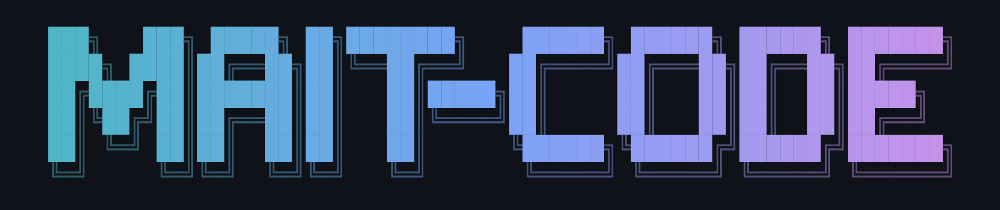
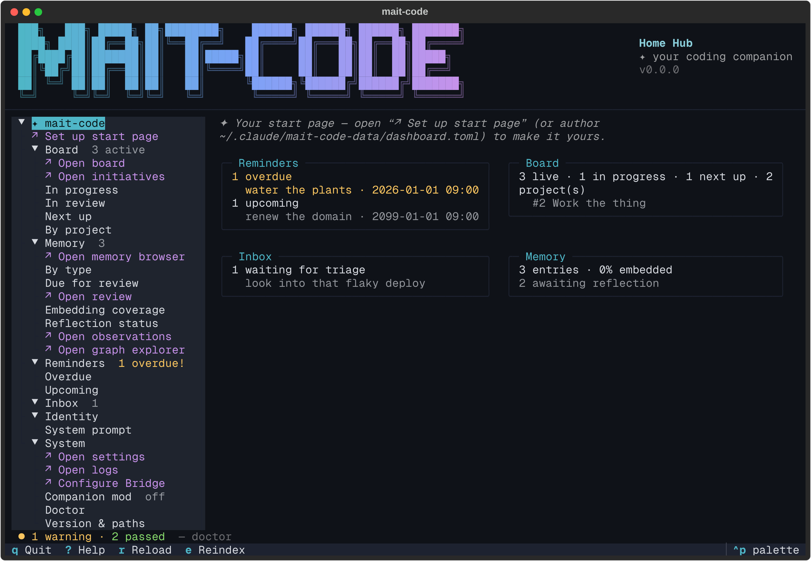
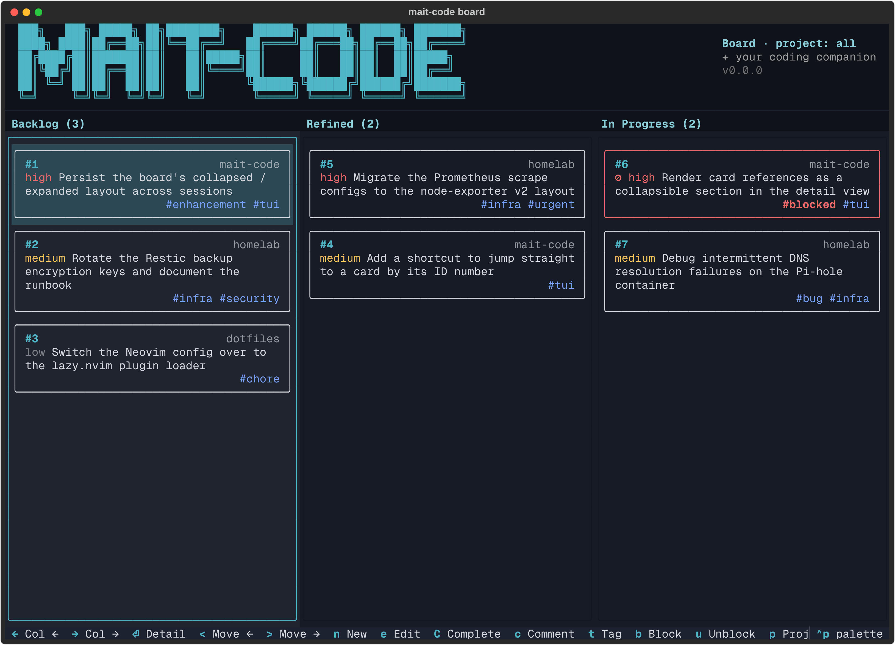
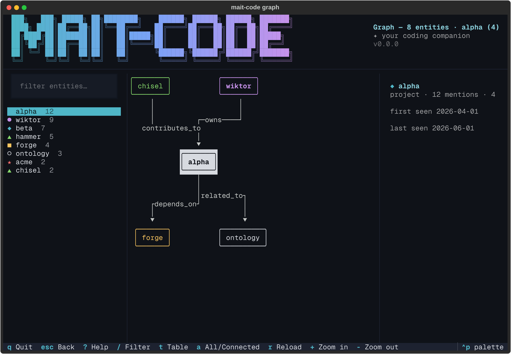
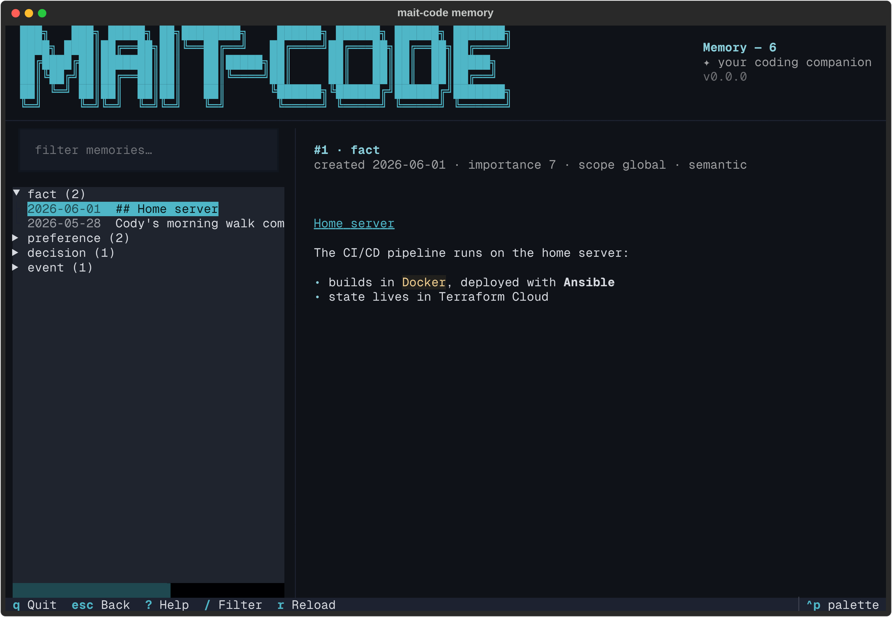
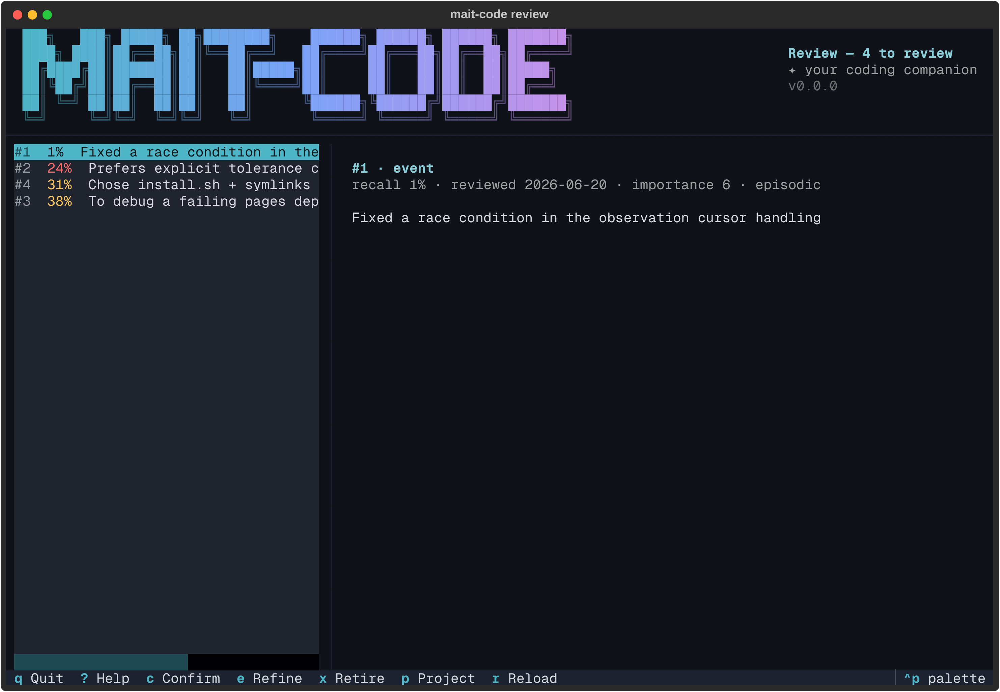
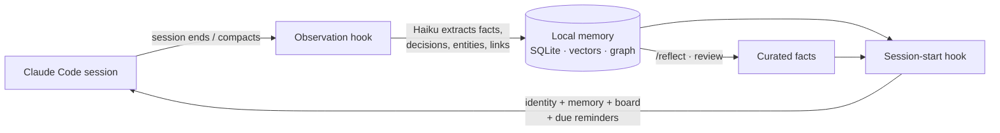

<p align="center">
  
</p>

<p align="center">
  <strong>Claude Code forgets you every session. Your mait doesn't.</strong>
</p>

<p align="center">
  <a href="https://github.com/wiktordepina/mait-code/actions/workflows/ci.yml"></a>
  <a href="https://wiktordepina.github.io/mait-code/"></a>
</p>

<p align="center">
  <a href="https://wiktordepina.github.io/mait-code/">Documentation</a> ·
  <a href="#get-started-in-one-line">Install</a> ·
  <a href="docs/philosophy.md">Why "mait"?</a>
</p>

---

mait-code turns [Claude Code](https://docs.anthropic.com/en/docs/claude-code) into a
coding companion that remembers your projects, your preferences and the decisions you've
already made. It picks up where you left off, keeps track of your work, and has the
nerve to tell you when you're about to repeat last month's mistake.

```text
you   › let's just wrap the deploy in a retry loop with a sleep

mait  › We did exactly that in the homelab pipeline back in June. It hid a
        real failure for a week before you swapped it for `--wait` with a
        timeout. I'd do the same here. Card #12 for the flaky deploy is
        still on the board, too, if you fancy picking it up while we're in
        there.
```

<sub>An illustrative exchange. The memory, the board and the pushback are all real features.</sub>

<p align="center">
  
</p>

## What you get

### 🧠 It remembers

Every session is quietly read once it ends. Facts, preferences, decisions, people and
how they relate get pulled out and stored, scoped to the whole machine, one project or a
single branch. The next session starts with the relevant context already loaded, so you
don't have to re-explain yourself.

- **Hybrid search** over everything it has learnt, combining keywords and meaning, via `/recall`
- **A knowledge graph** of the projects, tools and people in your work, built up automatically
- **Memory that stays true.** Important memories that are getting old come back up for review,
  so you can confirm, refine or retire them, and `/reflect` turns recent learnings into
  curated facts

### 🗣️ It has a personality, and you write it

A plain-English **soul document** sets its values and how it disagrees. A
**user context** file tells it who you are. It's built to push back, to ask rather than
assume, and to point out patterns it notices. You get a mate who's read the codebase, not
a yes-machine. The [philosophy](docs/philosophy.md) explains why.

### 📋 It keeps track of the work

- **A kanban board that spans all your projects.** Ask it to pick up, refine or finish a card
  straight from a session.
- **Reminders** that come up at session start once they're due (`/remind`, `/reminders`).
- **A quick-capture inbox** for "oh, I should look at…" thoughts, with `/triage` to route each
  one to the board or to memory.
- **The Bridge** (opt-in): capture from your phone and get reminders as notifications, with a
  Done button that ticks them off back home.

### 🖥️ It lives in your terminal

Run `mait-code` and you get a set of full-screen terminal apps that share one theme: a home hub
with your own start page, the board, a memory browser, a review queue, a knowledge-graph
explorer, an observations browser, a log viewer and a settings editor.

<table>
  <tr>
    <td></td>
    <td></td>
  </tr>
  <tr>
    <td align="center"><sub><code>mait-code board</code>: one board, every project</sub></td>
    <td align="center"><sub><code>mait-code graph</code>: what it knows, and how it connects</sub></td>
  </tr>
  <tr>
    <td></td>
    <td></td>
  </tr>
  <tr>
    <td align="center"><sub><code>mait-code memory</code>: browse and filter everything it remembers</sub></td>
    <td align="center"><sub><code>mait-code review</code>: keep ageing memories honest</sub></td>
  </tr>
</table>

## How it works

There are no daemons and nothing running in the background. Everything happens in response
to something: a Claude Code hook firing, a skill you invoke, or a CLI tool you run.



## Built to be trusted

- **Your data stays on your machine.** Memory is a local SQLite database, and embeddings run
  locally by default (AWS Bedrock is optional).
- **Extraction can't act.** The model that reads your transcripts runs with no tools, so a
  transcript can't trick it into doing anything.
- **Anything that touches the network is opt-in.** The Bridge makes zero network calls until you
  switch it on, which matters on a locked-down work laptop.
- **You can see exactly what it sees.** The home hub shows the full system prompt your companion
  starts each session with.
- **Well tested.** Over 2,400 tests, including snapshot tests for every terminal app.

## Get started in one line

```bash
curl -fsSL https://raw.githubusercontent.com/wiktordepina/mait-code/main/scripts/bootstrap.sh | bash
```

This installs [uv](https://docs.astral.sh/uv/) if you don't have it, installs the latest
release and wires everything into `~/.claude/`. Upgrade later with `mait-code update`. Then make
the companion yours:

```bash
$EDITOR ~/.claude/mait-code-data/soul_document.md   # who it is
$EDITOR ~/.claude/mait-code-data/user_context.md    # who you are
claude                                              # and say hello
```

You'll need the [Claude Code](https://docs.anthropic.com/en/docs/claude-code) CLI. uv takes
care of Python (≥ 3.13). Want to read the script first, pin a version or use Bedrock
embeddings? The [setup guide](docs/setup.md) covers all of that, plus `mait-code update` and
`mait-code uninstall` (which keeps your data unless you ask it not to).

## Learn more

- [Philosophy](docs/philosophy.md): companion, not assistant
- [How memory works](docs/memory.md): observations, search, embeddings, reflection
- [Architecture](docs/architecture.md): design and the decisions behind it
- [Skills reference](docs/reference/skills.md): every slash command
- [Multi-machine sync](docs/sync.md) and [the Bridge](docs/bridge.md)
- [Development guide](docs/development.md): hacking on mait-code itself

Each terminal app has its own guide on the [documentation site](https://wiktordepina.github.io/mait-code/).

---

<p align="center"><sub><b>mait</b> = <i>mate</i> + <i>AI</i>. The AI sits inside the word, not in front of it.</sub></p>
