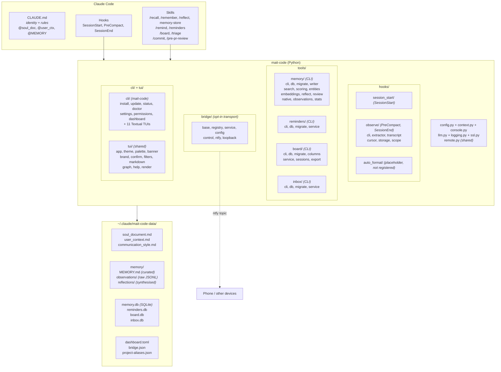
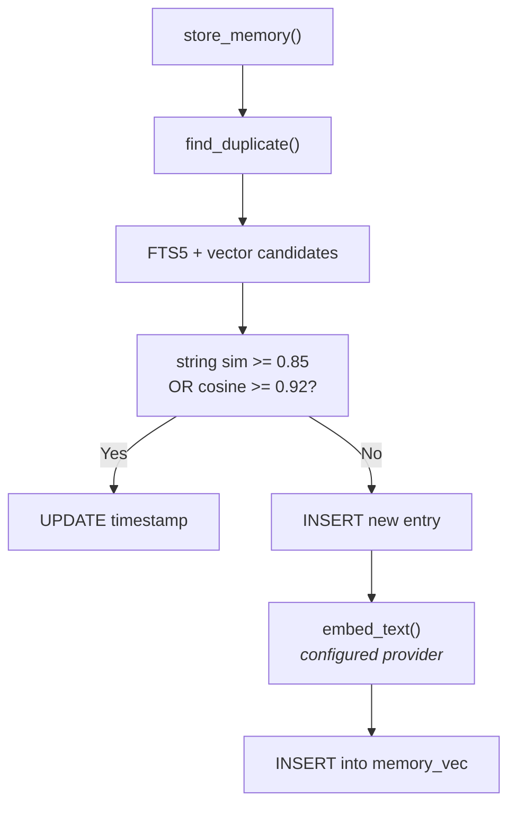
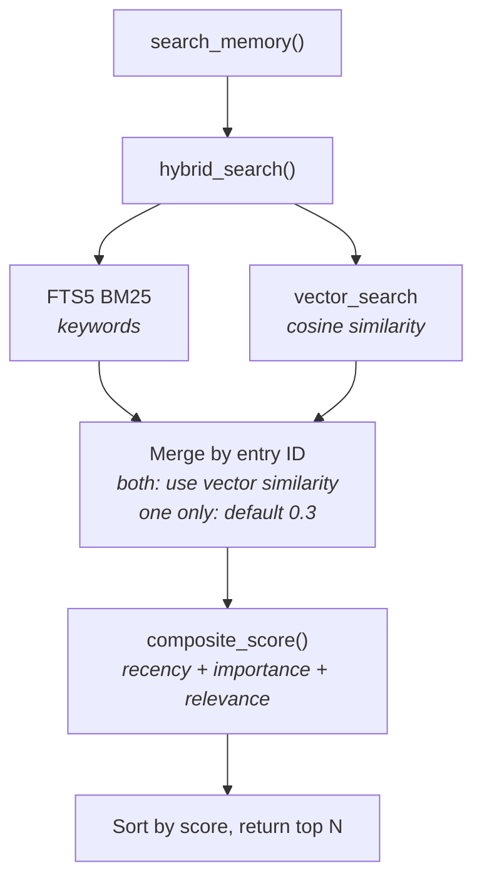
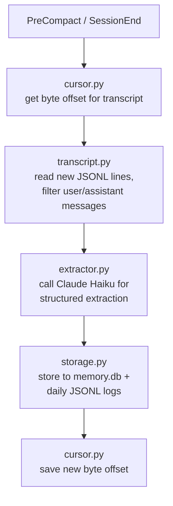

# Architecture

## Design Principles

1. **No background services** — Everything runs reactively in response to Claude Code events (hooks, CLI invocations). No daemons, no cron jobs.
2. **Standalone project** — Self-contained Python package managed by `uv`. No system-wide installation required.
3. **Memory-first** — The memory system is the core differentiator. All other features feed into or read from memory.
4. **Companion identity** — Not a generic assistant. The soul document and user context create a consistent personality.
5. **uv-managed** — Packaging and environments are `uv`'s job; no manual venv activation. A shipped install is `uv tool install`, so `mait-code` and the `mc-tool-*` entry points are called directly; `uv run` is the development path.
6. **CLI tools + skills over MCP** — Simpler, no process overhead, preprocessing injects results before Claude sees the prompt.

## System Architecture



## Memory Architecture

### Overview

The memory system combines three tiers of storage with a SQLite database for structured search. Raw observations flow in from hooks, get indexed in the database, and the highest-confidence facts are promoted to MEMORY.md for always-on context.

### Database Schema

The memory database (`memory.db`) uses SQLite with two extensions:

**Core table: `memory_entries`**

| Column | Type | Description |
|--------|------|-------------|
| `id` | INTEGER PK | Auto-incrementing identifier |
| `content` | TEXT | The memory content |
| `entry_type` | TEXT | fact, preference, event, decision, insight, task, relationship, procedure |
| `importance` | INTEGER | 1-10 scale (default 5) |
| `memory_class` | TEXT | episodic, semantic, or procedural (controls decay rate) |
| `scope` | TEXT | `global`, `project`, or `branch` (default `global`) |
| `project` | TEXT | Project identifier (null for global scope) |
| `branch` | TEXT | Git branch (set only for branch scope) |
| `created_at` | DATETIME | Timestamp of creation |
| `reviewed_at` | DATETIME | Anchor the review decay curve restarts from; NULL reads as `created_at` |
| `superseded_by` | INTEGER FK | The entry that replaced this one (null while live) |
| `superseded_at` | DATETIME | When the entry was superseded or retired (null while live) |
| `source` | TEXT | What wrote the entry when not a session's observe hook (e.g. `job` from `mc-tool-memory observe`); null otherwise |

**Scope semantics:**

- **global** — visible everywhere, `project` and `branch` are null
- **project** — visible across all branches of one project, `project` set, `branch` null
- **branch** — visible only on one branch of one project, both set
- Default at write time: `branch` if both project+branch detected, else `project` if project detected, else `global`. Override with `--scope`.
- Query-time default: filter by current context; `--scope all` disables filtering.

**Entry type to memory class mapping:**

- **Episodic** (fast decay, 3-day half-life): `event`, `task`
- **Semantic** (slow decay, 90-day half-life): `fact`, `preference`, `decision`, `insight`, `relationship`
- **Procedural** (slowest decay, 180-day half-life): `procedure`

**FTS5 virtual table: `memory_entries_fts`**
- Full-text search with BM25 ranking
- Kept in sync via triggers on insert/update/delete

**Vec0 virtual table: `memory_vec`**
- Cosine distance vectors via `sqlite-vec` (768d for local/nomic, 1024d for Bedrock/Titan)
- Populated by the configured embedding provider (local fastembed or AWS Bedrock)
- Embeddings are computed and stored automatically when new memory entries are created
- Delete trigger (`memory_entries_vec_ad`) keeps vec table in sync when entries are removed
- Dimension is a deployment-time decision; `mc-tool-memory reindex` handles migration

**Entity table: `memory_entities`**

| Column | Type | Description |
|--------|------|-------------|
| `id` | INTEGER PK | Auto-incrementing identifier |
| `name` | TEXT UNIQUE NOCASE | Entity name (case-insensitive) |
| `entity_type` | TEXT | person, project, tool, service, concept, org, unknown |
| `first_seen` | DATETIME | When the entity was first observed |
| `last_seen` | DATETIME | When the entity was last mentioned |
| `mention_count` | INTEGER | How many times the entity has been seen |

**Relationship table: `memory_relationships`**

| Column | Type | Description |
|--------|------|-------------|
| `id` | INTEGER PK | Auto-incrementing identifier |
| `source_entity_id` | INTEGER FK | References memory_entities |
| `target_entity_id` | INTEGER FK | References memory_entities |
| `relationship_type` | TEXT | uses, owns, contributes_to, depends_on, manages, related_to |
| `context` | TEXT | Description of the relationship |
| `first_seen` | DATETIME | When the relationship was first observed |
| `last_seen` | DATETIME | When the relationship was last seen |

Unique constraint on `(source_entity_id, target_entity_id, relationship_type)`.

**Indexes:**

- `idx_memory_entries_created_at` — temporal queries
- `idx_memory_entries_type` — type filtering
- `idx_memory_entries_importance` — importance ranking
- `idx_memory_entries_class` — class filtering
- `idx_memory_entries_scope` — scope filtering
- `idx_memory_entries_project` — project filtering
- `idx_memory_entries_project_scope` — combined project + scope lookups
- `idx_memory_entries_reviewed_at` — review resurfacing
- `idx_memory_entries_superseded` — partial index over superseded rows (history lookups)
- `idx_entities_name` — entity name lookup
- `idx_entities_type` — entity type filtering
- `idx_rel_unique` — relationship deduplication
- `idx_rel_source`, `idx_rel_target` — relationship traversal

**Reflection state: `reflection_watermark`**

Tracks the last `memory_entries.id` reflected on per project, so `/reflect` is idempotent across runs. Primary key on `project` (empty string for global). Columns: `project`, `last_reflected_id`, `last_reflected_at`.

**Embedding record: `memory_meta`**

A `key`/`value` table recording which provider, model and width built the stored vectors, so every vector path can refuse to compare against vectors from a different model. Written by `reindex` or by the first vector into an empty table — never by a migration. See [the embedding record](memory.md#the-embedding-record).

### Composite Scoring

Memory retrieval results are ranked by a composite score:

```
score = (0.3 × recency + 0.3 × importance + 0.4 × relevance) × scope_boost
```

The scope boost scales the whole weighted base: `1.0` for a branch match, `0.85`
for a project match (both fixed), and `scope-boost-global` / `scope-boost-cross-project`
for the wider scopes.

**Recency** uses exponential decay:

- `recency = exp(-ln(2) × age_days / half_life)`
- Episodic half-life: 3 days (events decay fast)
- Semantic half-life: 90 days (facts persist)
- Procedural half-life: 180 days (workflows go stale when superseded, not with time)
- Default half-life: 7 days (unknown or missing class)

**Importance** is normalized from 1-10 to 0.0-1.0:

- `importance_norm = (importance - 1) / 9`

**Relevance** is provided by the search method:

- **Hybrid mode** (default): combines FTS5 BM25 with vector cosine similarity
- **FTS mode**: keyword-only BM25 ranking
- **Vector mode**: semantic similarity only via the configured embedding provider

### Deduplication

Before storing a new memory, the writer checks for near-duplicates (scoped to the
new entry's project **and entry type** — the same content stored as a different
type is never a duplicate) using two complementary measures:

1. Extract first 8 significant words (length > 2) from new content
2. Gather candidates from **both** FTS5 keyword search and vector similarity search
3. Compare each candidate two ways: `SequenceMatcher` string similarity and vector cosine similarity
4. If string similarity ≥ `dedup-string-threshold` (default 0.85) **or** cosine similarity ≥ `dedup-vector-threshold` (default 0.92): treat as a duplicate — update the existing entry's timestamp and keep max importance
5. If cosine similarity falls in the contradiction band `[dedup-conflict-threshold, dedup-vector-threshold)` (default `[0.60, 0.92)`): insert as new entry **and** return the near-neighbours as `potential_conflicts` so a stale fact can be superseded
6. If no match: insert as new entry

Superseded entries (replaced via `supersede_memory`) are excluded as dedup candidates and hidden from default search/listing.

### Data Flow





### Tier 1: Observations (raw)
- Extracted automatically by the `observe` hook at PreCompact and SessionEnd
- Stored as JSONL files in `memory/observations/YYYY-MM-DD.jsonl`
- Contains facts, decisions, code patterns, user preferences, entities, and relationships
- Indexed into `memory.db` for structured search
- Entities and relationships stored in the knowledge graph tables

### Tier 2: Reflections (synthesised)
- Generated by `/reflect` skill or `mc-tool-memory reflect` CLI
- Reads unreflected memory entries (tracked by per-project watermark)
- Calls Claude Haiku to identify patterns, themes, recurring issues
- Stores insights as `type=insight` (importance=6) in memory.db
- Proposes MEMORY.md additions for user approval
- Idempotent: watermark advances after each reflection; same entries never processed twice
- Batched: configurable batch size (default 50), `--drain` for full backlog processing

### Tier 3: MEMORY.md (curated)
- The highest-confidence facts, loaded into every session via CLAUDE.md
- Manually edited or updated by the reflection system
- Kept under ~150 lines for context budget

## Memory CLI Tool (`mc-tool-memory`)

Sync CLI tool invoked via Bash. Skills use preprocessing (`!`command``) or direct Bash calls.

| Subcommand | Args | Description |
|------------|------|-------------|
| `search` | query, --limit?, --type?, --mode?, --project?, --branch?, --scope? | Hybrid (FTS5 + vector) search with composite score re-ranking |
| `store` | content, --type?, --importance?, --project?, --branch?, --scope? | Store with deduplication, auto-computes embedding |
| `list` | --limit?, --type?, --since?, --include-superseded?, --source?, --project?, --branch?, --scope? | List recent entries, optionally filtered by type, time period (e.g. `24h`, `7d`, `1w`) or writing source; superseded entries are hidden unless asked for |
| `delete` | id | Delete by ID (vec cleanup via trigger) |
| `stats` | — | Counts by type, class, scope, project, embedding coverage, and provider info |
| `entities` | query?, --limit? | Search or list knowledge graph entities |
| `entities merge` | source, target | Fold an alias entity into another: relationships are repointed, mention counts summed, the source deleted |
| `relationships` | entity_name | Show relationships for an entity |
| `reindex` | — | Recompute vector embeddings for all entries |
| `restore` | --dry-run? | Restore memory database from observation JSONL log files, then reindex |
| `reflect` | --days?, --min-new?, --batch-size?, --drain?, --json?, --project?, --branch?, --scope? | Synthesise observations into insights, propose MEMORY.md updates (`--json` emits the insights and structured MEMORY.md operations) |
| `observe` | --file, --project, --branch?, --trigger?, --max-chars?, --json? | Extract and store observations from prepared text (e.g. a job digest) the way the observe hook does for a session; capped (no preferences, no global scope, importance ≤ 7), and `--trigger` (default `job`) becomes the entries' `source` |
| `canonicalize-projects` | --dry-run? | Rewrite stored project slugs per the project-alias map |
| `review` | --limit?, --json?, --project?, --branch?, --scope? | List memories due for review, most-decayed first |
| `reviewed` | id | Stamp `reviewed_at = now`, resetting the entry's decay curve |
| `supersede` | old_id, content, --importance? | Replace an entry with a revised version, keeping the old row for audit (importance inherits unless overridden) |
| `retire` | id \| --source, --project?, --yes?, --json? | Drop an entry from recall, keeping the row for audit; `--source` retires every live entry from one source (listing the matches until `--yes`) |
| `merge` | ids…, --into content, --importance? | Fold several entries into one, retiring the originals (importance defaults to the max among them) |

The scope flags (`--project`, `--branch`, `--scope`) are taken by `search`, `store`, `list`, `review` and `reflect`: `--project` and `--branch` override the auto-detected context; `--scope` filters or sets the entry scope (`global`, `project`, `branch`, or `all` — the last disables filtering at query time). `observe` takes its own required `--project` and optional `--branch`, and `retire --source` an optional `--project`.

## Memory Browser TUI (`mait-code memory`)

`mait-code memory` opens a full-screen, read-only master–detail browser over the memory store: a tree of memories grouped by entry type on the left (counts per group, newest first), the selected memory's body — rendered as markdown, plain text being a subset — plus its metadata (created, importance, scope, class) on the right. `/` focuses a live substring filter (groups expand to the matches, the subtitle reports the narrowed count), `p` narrows to one project (plus globals), `n` flips to the **native view** — Claude Code's own per-project auto-memory files under `~/.claude/projects/<slug>/memory/`, equally read-only (see [the native view](memory-browser.md#the-native-view)) — `r` re-reads the store, a `Ctrl+P` command palette exposes the actions, and `?` opens the context help screen. It deliberately browses *everything* — across projects and scopes — and performs no mutations: reading is its whole job, and writes stay with `mc-tool-memory`. It is built on Textual over the same query layer as the CLI tool (`search.list_entries`), following the house TUI conventions: a TTY-gated launch (piped or redirected, it prints a grouped read-only summary instead), a lazily-imported app off the hot path of every other command, and a single connection held for the app's lifetime.

## Review Queue TUI (`mait-code review`)

`mait-code review` is the memory browser's writing counterpart: a queue of curated memories whose recall probability has decayed below `review-threshold` while their importance sits at or above `review-min-importance`, most-decayed first. Where the browser deliberately never writes, this surface exists to write — each entry gets one of three verbs, and each backs the same store operation the CLI exposes: `c` confirm (`mark_reviewed`, resetting the decay curve), `e` refine (an editor that supersedes the entry on save), `x` retire (behind a confirm, since it hides a fact from recall). Moving the highlight without choosing leaves the memory in the queue. `p` narrows to one project using the memory browser's picker, `r` recomputes the queue. The resurfacing query lives in `tools/memory/review.py` and decays from the `reviewed_at` anchor (migration 13) rather than `created_at`, so a memory's clock restarts when it is confirmed, not when it was first stored — the recall figure is a decay function, not a usage count, since nothing tracks retrieval. Same house conventions: TTY-gated (piped, it prints the due list as text), lazily imported, one connection for the app's lifetime.

## Observations Browser TUI (`mait-code observations`)

`mait-code observations` is the memory browser's sibling over the **raw extraction tier**: a read-only master–detail browser of every non-insight entry, grouped by capture day (newest first), each flagged **pending** or **reflected** against the reflection watermark — so what reads pending here is precisely what the next `/reflect` run will consider. Highlighting a day renders its capture sessions (trigger, project, per-category extraction counts) from the daily JSONL logs; highlighting an entry renders its body and metadata, including its reflection standing. `/` filters live by content; `p` narrows to one project via a `Select` dropdown (the board's filter pattern) and judges entries against *that project's* watermark, since reflection runs per-project. The query layer lives in `tools/memory/observations.py` — `memory.db` is the operative source (the watermark is defined over its entry IDs); the JSONL logs contribute only per-capture metadata, read best-effort. Same house conventions: TTY-gated (a day-grouped text summary when piped), lazily imported, one connection for the app's lifetime, and no mutations — synthesis stays with `/reflect`.

## Board Database

The board database (`board.db`) stores a single cross-project kanban board. Cards carry a `project` field — so one board serves every project and UIs filter by it — and move through a fixed, hardcoded column workflow.

**Cards table: `cards`**

| Column | Type | Description |
|--------|------|-------------|
| `id` | INTEGER PK | Auto-incrementing identifier |
| `project` | TEXT | Project identifier (free-form; defaults to basename of git root or cwd) |
| `title` | TEXT | Card title |
| `description` | TEXT | The what/why |
| `acceptance_criteria` | TEXT | Definition-of-done; filled by the refine step |
| `status` | TEXT | Column: `backlog`, `refined`, `in_progress`, `in_review`, `done`, or `archived` (default `backlog`) |
| `priority` | TEXT | `low`, `medium`, or `high` (default `medium`) |
| `completion_summary` | TEXT | Handoff summary, set when moved to `done` |
| `created_at` | DATETIME | Timestamp of creation |
| `updated_at` | DATETIME | Timestamp of last mutation |
| `completed_at` | DATETIME | Timestamp of completion (null unless `done`) |
| `created_by` | TEXT | Provenance: the client that raised the card through [`mait_code.remote`](remote.md#provenance); null when created locally |
| `kind` | TEXT | `card` or `epic` (default `card`) |
| `parent_id` | INTEGER FK | The epic the card belongs to; `ON DELETE SET NULL` |

**Comments table: `card_comments`**

| Column | Type | Description |
|--------|------|-------------|
| `id` | INTEGER PK | Auto-incrementing identifier |
| `card_id` | INTEGER FK | References `cards(id)`; `ON DELETE CASCADE` |
| `author` | TEXT | `me` or `claude` (default `me`) |
| `body` | TEXT | Comment text |
| `created_at` | DATETIME | Timestamp of creation |

**Tags table: `card_tags`**

| Column | Type | Description |
|--------|------|-------------|
| `card_id` | INTEGER FK | References `cards(id)`; `ON DELETE CASCADE` |
| `tag` | TEXT | Free-form tag value; `UNIQUE(card_id, tag)` makes adding idempotent |

Free-form tags ride alongside a card's status. `blocked` is the first consumer: blocking tags a card in place rather than moving it, so the card keeps its real flow position. Each card dict carries a sorted `tags` list.

**References table: `card_references`**

| Column | Type | Description |
|--------|------|-------------|
| `id` | INTEGER PK | Auto-incrementing identifier |
| `card_id` | INTEGER FK | References `cards(id)`; `ON DELETE CASCADE` |
| `position` | INTEGER | 1-based order on the card |
| `label` | TEXT | Reference label (e.g. `PR`, `JIRA`, `from`) |
| `value` | TEXT | URL, `file://` path, or bare ID |

**Session bindings: `card_sessions`**

| Column | Type | Description |
|--------|------|-------------|
| `card_id` | INTEGER FK | References `cards(id)`; `ON DELETE CASCADE` |
| `session_id` | TEXT | Claude Code session id; `UNIQUE(card_id, session_id)` |
| `pid` | INTEGER | The Claude Code process serving it — how a binding is known to be live and how it follows a `/clear` |
| `bound_at` | TEXT | Timestamp of binding |

**Playbook runs: `card_runs` and `card_run_steps`**

| Column | Type | Description |
|--------|------|-------------|
| `card_runs.id` | INTEGER PK | Auto-increment; a card's latest run has the highest id |
| `card_runs.card_id` | INTEGER FK | References `cards(id)`; `ON DELETE CASCADE` |
| `card_runs.playbook` | TEXT | The playbook's name, e.g. `work` |
| `card_runs.started_at` / `updated_at` | TEXT | When the run started; when it or a step last changed |
| `card_runs.ended_at` | TEXT | `NULL` while open; a partial unique index allows one open run per card |
| `card_run_steps.run_id` | INTEGER FK | References `card_runs(id)`; `ON DELETE CASCADE` |
| `card_run_steps.position` / `name` | INTEGER / TEXT | 1-based order and the playbook's step name; primary key `(run_id, position)` |
| `card_run_steps.status` | TEXT | `CHECK`: `pending`, `in_progress`, `done`, `skipped`, `paused`; a partial unique index allows one `in_progress` step per run |
| `card_run_steps.reason` | TEXT | Why a step was skipped (required) or paused (optional) |
| `card_run_steps.started_at` / `finished_at` | TEXT | Set and cleared by the step rules in `service.set_step` |

**Links table: `card_links`**

| Column | Type | Description |
|--------|------|-------------|
| `from_id` | INTEGER FK | The blocking card; `ON DELETE CASCADE` |
| `type` | TEXT | `blocks` (the only type) |
| `to_id` | INTEGER FK | The card that waits; `ON DELETE CASCADE` |
| `created_at` | TEXT | Timestamp of creation |

Primary key on `(from_id, type, to_id)`; a card cannot link to itself, and the service refuses a link that would close a loop.

**Columns are fixed, not configurable.** `backlog → refined → in_progress → in_review → done` is the whole flow; `archived` is a hidden terminal excluded from default views. `blocked` is **not** a column — it is a tag carried in place (via `block`/`unblock`), so a blocked card keeps its real status. The constants live in `src/mait_code/tools/board/columns.py`. Project detection uses `mait_code.context.get_project()`; pass `--project` for work with no git repo (e.g. an app idea).

**Relationships.** Two cross-project relationships sit on top of the columns (see [Epics and dependencies](board.md#epics-and-dependencies)):

- **Epics** — a `kind = 'epic'` card is an umbrella over member cards (their `parent_id`). Epics carry the reserved project `@epic`, so they stay off the kanban, the counts and `next`; one level only, at most one epic per card.
- **`blocks` links** — `link A blocks B` records that B can't start until A is done. `next` hands out only **ready** cards: refined, not an epic, not tagged `blocked`, not waiting on a blocker that is neither done nor archived, and not bound to a live session other than the caller's.
- **Origin** — `add --from N` records where a split-off or follow-up card came from as a `from` → `#N` reference (provenance, never ordering) and inherits N's epic unless `--parent` says otherwise.

**Session binding.** `card_sessions` ties open cards, in any column, to the Claude Code sessions working them. Entering `in_review` or closing a card (`done`, `archived`, epic promotion — every close path runs `service._on_close`) releases its bindings. `sessions.py` is the only reader of `$CLAUDE_CODE_SESSION_ID`/`$CLAUDE_PID`, so the service layer stays environment-free; the session-start hook names a session's bound cards, moves bindings across `resume`/`clear`, and prunes dead bindings older than two weeks. See [Parallel sessions](board.md#parallel-sessions).

## Board CLI Tool (`mc-tool-board`)

Manually-driven kanban board. Claude in the live session acts as the worker ("pick up the next refined card"); there is no autonomous dispatcher — *you* drive the board. Cards are project-scoped via the basename of the git root (or cwd), stored in a shared `board.db`. Read commands accept `--json` for UI/skill consumption, and every mutating subcommand takes `--json` to emit the affected card (for `link`/`unlink`, card B; for `remove`, the card as it was) instead of a confirmation line — so `--json` is left out of the table below.

| Subcommand | Args | Description |
|------------|------|-------------|
| `add` | title, --description?, --priority?, --project?, --epic?, --parent?, --from? | Add a card to the backlog; `--epic` adds an epic instead, `--parent` puts the card in one (`none` to drop an inherited one), `--from N` records its origin and inherits N's epic |
| `list` | --all?, --status?, --archived?, --search/-q?, --epic?, --ready?, --mine? \| --session?, --json? | List cards grouped by column (current project by default; archived hidden); `-q` filters by title, `--epic` keeps one epic's members (any project), `--ready` keeps what `next` could hand out, `--mine`/`--session` keep cards bound to a session, across all projects |
| `show` | id, --json? | Show a card, its relationships and its comment thread |
| `move` | id, status | Move a card to any column (sets/clears `completed_at` around `done`; into `in_progress` binds the current session, out of it releases bindings) |
| `refine` | id, --description?, --acceptance? | Set description/acceptance and move to `refined` |
| `next` | --project?, --epic?, --claim?, --json? | Show the next ready card (priority, then oldest); `--epic` picks from one epic's members in any project; `--claim` moves it to `in_progress` and binds the current session |
| `review` | id, --pr? | Move a card to `in_review`; `--pr` records the pull request as a `PR` reference |
| `complete` | id, --summary? | Move to `done` with a completion summary |
| `block` | id, reason? | Tag the card `blocked` in place (keeps its column); an optional reason is recorded as a comment |
| `unblock` | id | Remove the `blocked` tag (keeps the card's flow position) |
| `tag` | id, tag | Add a free-form tag to a card |
| `untag` | id, tag | Remove a tag from a card |
| `link` | A, `blocks`, B | Record that card B can't start until A is done (refused if it would close a loop) |
| `unlink` | A, `blocks`, B | Remove a `blocks` link |
| `epic list` | --done?, --json? | Open epics with member progress (`--done` includes finished ones) |
| `epic show` | id, --json? | An epic and its members, column by column |
| `epic promote` | id | Turn an existing card into an epic |
| `ref add` | id, label, value | Append a label→value reference (URL, `file://` path, or bare ID) to a card |
| `ref remove` | id, position | Remove a reference by its 1-based position (see `ref list`) |
| `ref list` | id, --json? | List a card's references in order |
| `archive` | id | Archive a card (hidden, not deleted) |
| `bind` | id, --session? --pid? | Bind a Claude Code session (default: `$CLAUDE_CODE_SESSION_ID`/`$CLAUDE_PID`) to an open card (not Done or Archived); refused without both, and `--session` needs its own `--pid` |
| `unbind` | id, --session? | Drop a session's binding from a card |
| `run start` | id, --playbook, --steps…, --replace? | Start a playbook run: its ordered steps, all pending; refused while a run is open unless `--replace` |
| `run step` | id, step, status, --reason? | Set one step (by position or exact name) to `pending`/`in_progress`/`done`/`skipped`/`paused` |
| `run end` | id | End the card's open run, keeping it as history |
| `run show` | id, --json? | Show the card's open run (`null` with `--json` when there is none) |
| `comment` | id, body, --author? | Append a comment (author `me` or `claude`) |
| `edit` | id, --title?, --description?, --priority?, --acceptance?, --project?, --parent? | Edit card fields; `--parent none` takes the card out of its epic |
| `remove` | id | Delete a card permanently (cascades comments) |
| `summary` | --all?, --project?, --session?, --json? | Per-column counts (the session-start hook reads the same counts via `service.summary_counts`); `--session ID` (with `--json`) adds that session's bound cards, the In Review cards and the inbox count |
| `export` | id?, --format?, --out?, --all?, --project?, --status?, --archived?, --search?, --epic? | Export one card, one epic with its members, or the whole board as markdown or JSON (stdout, or a file with `--out`) |

Every query and mutation — including the done-invariant (`completed_at` is set on entering `done` and cleared on leaving), the session-invariant (entering `in_review` or closing a card releases every `card_sessions` binding) and the run rules (closing a card ends its open run) — lives in `src/mait_code/tools/board/service.py`, a presentation-agnostic layer over an open connection. The argparse handlers and the TUI both sit on top of it, so there is a single source of truth for the SQL and the workflow rules.

## Board TUI (`mait-code board`)

`mait-code board` opens a full-screen, interactive kanban — one pane per status side by side, every project's cards visible with a `p` project-filter dropdown, arrow-key navigation, `<`/`>` to move a card along the flow (`backlog → refined → in_progress → in_review → done`; In Review hides itself while empty unless `v` reveals it), `t` to toggle a tag and `b`/`u` to tag/untag `blocked` in place, plus a near-fullscreen card screen (`Enter`) that shows the card with its comment thread and flips to an edit form in place with `e`. That form is the single place a card is changed: title, priority, **status**, **tags**, **references**, description and acceptance criteria all on one form. Tags, references and status are a working copy — Save applies them together and returns to the view; cancel discards every pending change. Block/unblock stay outside the form (they carry a reason comment a plain tag can't), so the form's tag editor leaves `blocked` alone. `n` creates a card, `C` completes one with a handoff summary, and `c` comments. The card screen carries a References section — a list of label→value links, clickable where the value is a URL or `file://` path. Priority and tags render as domain-coloured chips on the card rows (`blocked` distinct in the error colour). A `Ctrl+P` command palette exposes every action, `?` opens a context help screen built from the live key-bindings, number keys jump between columns, and actions raise toasts. It is built on Textual and reuses the board `service.py`, mirroring the `mait-code settings` editor: a TTY-gated launch (piped or redirected, it prints a grouped read-only render instead), a lazily-imported app off the hot path of every other command, and a single connection held for the app's lifetime.

`i` swaps the kanban for the **Initiatives view** (or launch straight into it with `mait-code board --initiatives`): every open epic with its progress beside a table of the highlighted epic's members from every project, ready ones first. There, `g` swaps the table for the epic's `blocks` dependency diagram, drawn top-down on the shared `tui/graph.py` view the graph explorer also uses. The card screen gains a **Relationships** section — the card's epic, its blockers and what it unblocks. Keys and screenshots live in the [board guide](board.md#initiatives-view).

The board TUI is **on-demand and foreground** — it is launched explicitly, runs until you quit with `q`, and leaves nothing behind. The *No background services* principle is intact: there is no daemon polling the board, only a short-lived app you open when you want to see it.

## Inbox Database

The inbox database (`inbox.db`) backs a single frictionless quick-capture holding pen — a "capture now, sort later" store so a thought can be dumped without deciding upfront whether it is a board card or a memory.

**Inbox table: `inbox_items`**

| Column | Type | Description |
|--------|------|-------------|
| `id` | INTEGER PK | Auto-incrementing identifier |
| `body` | TEXT | The captured thought |
| `project` | TEXT | Capture-context project (a routing hint; nullable — the store is global) |
| `created_at` | TEXT | Timestamp of capture |

Unlike the board, the inbox is **global, not project-scoped** — `project` is only a hint to help triage route the item later.

## Inbox CLI Tool (`mc-tool-inbox`)

A thin capture-and-drain CLI over `inbox.db`. `add "<text>"` captures an item (frictionless — no flags required), `list [--json]` shows the inbox oldest-first, `remove <id>` drains an item out, `count` prints the item total (the session-start hook reads the same count via `service.count_items`), and `drain` pulls any captures waiting on the [Bridge](bridge.md) into the inbox. Queries and mutations live in `src/mait_code/tools/inbox/service.py`, the presentation-agnostic layer mirroring the board's `cli`/`service`/`db` split.

The intended lifecycle is **capture → triage → empty**: the `/triage` skill walks the captured items, proposes a destination for each (board card or memory), creates it on the user's confirmation, and removes the item — keeping the inbox near-empty rather than letting it become a second backlog. Routing is suggestion-based: the companion proposes, the user decides.

## Reminders CLI Tool (`mc-tool-reminders`)

| Subcommand | Args | Description |
|------------|------|-------------|
| `set` | when, what | Schedule a reminder with natural language time parsing |
| `list` | --all? | List active (or all) reminders |
| `dismiss` | id | Dismiss a reminder by ID |
| `check` | — | Check for overdue reminders (the session-start hook builds the same text via `tools/reminders/service.py`) |

## Home Hub TUI (`mait-code home`)

`mait-code home` — or just `mait-code` with no subcommand on a terminal — opens the companion's front door: a tree-navigable hub over everything mait-code, not an at-a-glance readout. A slim **tree sidebar** (under a third of the width) lists the sections — Board, Memory, Reminders, Inbox, Identity, System — each tree node carrying a live status badge (active card count, memory total, overdue reminders in alarm colour, inbox count). The **detail pane** beside it renders the highlighted node in full, with no glance clipping: the whole live-card breakdown, the per-type memory tables, the complete `doctor` check list. A one-line install-health verdict (reusing the `doctor` checks) sits under the tree, and the installed version shows in the brand header. `r` re-reads every store (refreshing badges and the open detail), `e` embeds the memory entries missing a vector after a confirm (it suspends to the terminal so the reindex progress prints normally), **System ▸ Companion mod** toggles the `mods` setting (enabling asks first; see [the companion mod](companion-mod.md)) — the hub's only two writes — `j`/`k` and the arrows move the cursor, and a `Ctrl+P` palette exposes the actions.

Pressing **Enter** on a launch leaf — the board, the board's Initiatives view, the memory browser, the review queue, the observations browser, the graph explorer, the settings editor, the log viewer, the Bridge configurator, or the start-page setup editor — leaves home and opens that dedicated TUI; when it quits, home re-opens with freshly recomputed badges. The handoff is an exit-and-relaunch loop in the `home` command (`_run_home_loop`): home exits its event loop returning a `HomeTarget`, the loop launches that app, then re-enters a fresh home — one process, no nested event loops, and each launched app runs unchanged. The **Identity → System prompt** node renders what the companion is presented with at session start: the identity stack (soul document, user context, curated MEMORY.md) read from the data dir, then the live output of the session-start hook's context builder. It calls the same `build_session_context()` the hook calls, so the text on screen is exactly the text a new session opens with, less the per-session section naming the cards a session is bound to (the hub has no session).

This is also where the brand lives: the box-drawing wordmark — a plain-text fallback on narrow terminals, a half-height variant on short ones — the signature glyph, and the companion voice in every empty state, all from `mait_code.tui.brand`. The `BrandBanner` (`mait_code.tui.banner`) wraps them into one size-responsive masthead worn by every TUI in place of a stock header, carrying each surface's view name over the tagline and version. The hub follows the house TUI conventions: presentation over the same store layers the `mc-tool-*` CLIs use (nothing shells out, and nothing writes beyond the reindex and the mod toggle), a TTY-gated launch (piped or redirected, `mait-code home` prints a compact text summary and bare `mait-code` keeps printing help), and per-view best-effort loading so one broken store renders a snag line rather than taking the hub down.

## The Start Page (`dashboard.toml`)

The home hub's root node renders a **user-authored start page** rather than a fixed readout: a grid of tiles declared in `dashboard.toml` in the data directory, one to four columns wide. A tile is either a **built-in widget** — the six in `_dashboard.py`'s `BUILTIN_WIDGETS`, reading the same store layers as the rest of the hub — or an arbitrary **shell command** whose stdout fills the tile. Shell tiles are what make the page personal (a `git log`, a deploy status, a weather one-liner) and are also the risk surface, so each runs under `dashboard-tile-timeout` seconds (default `5`) and a failure renders a snag line in that tile instead of taking the page down. The guided setup editor (`_dashboard_tui.py`, reachable from the hub or its command palette) writes the TOML so the format stays an implementation detail unless you want it. Loading and validation live in `cli/_dashboard.py`, kept separate from the TUI so the config can be parsed and checked without a terminal.

## The Bridge (`bridge/`)

The Bridge is the companion's optional link to devices that aren't the terminal — capture in, notifications out. It is **disabled by default and makes zero network calls while disabled**: the drain short-circuits before any request. That default is deliberate rather than cautious-by-habit — enabling it means outbound network access, which a work machine under corporate policy may not permit, so it is a per-machine opt-in.

The package is a small pluggable-channel design: `base.py` defines the channel protocol, `registry.py` maps a `bridge-type` setting to an implementation, and `service.py` holds the transport-agnostic drain/publish logic. Two channels ship — `ntfy.py` (a private [ntfy](https://ntfy.sh) topic, the real one) and `loopback.py` (in-process, for tests). Channel credentials live in `bridge.json` in the data directory; the per-machine drain watermark lives beside it in `bridge-state.json`, which is why that file must not be synced between machines.

Both directions ride the existing reactive triggers rather than a daemon: the session-start hook and `mc-tool-inbox drain` pull captures into the inbox, and the session-start hook and `mc-tool-reminders check` publish due reminders outward. A published reminder carries a **Done** action that posts `mait-ctl:dismiss:<id>` back to the capture topic; `control.py` intercepts any `mait-ctl:`-prefixed inbound message as a command rather than filing it as a capture, and the next drain dismisses the reminder. Each reminder publishes once, guarded by a `notified_at` stamp. `doctor` checks the Bridge but only ever warns — an unreachable phone is not a broken install.

## The Remote API (`remote.py`)

`mait_code.remote` is the narrow surface another machine or agent may touch: list and read cards, raise and refine them, search memories, check that memory search can use its vectors, and list reminders. It is a **Python module, not a server** — a separate host service (typically one speaking MCP) imports it and owns the listening, authentication and per-client scopes, so mait-code itself never opens a port and *No background services* holds. What it can't do (delete, archive, move into In Progress or beyond, write memories) simply has no function, and a test pins the public names to an allowlist. Writes name their caller: `create_card` records it in `cards.created_by`. See [the remote API](remote.md).

## The Companion Mod (`mods/`)

`mods/mait-companion/` is an optional Claude Code mod (on the early-access mods API) that adds `/capture` and a status bar above the prompt. It is **off by default**: with the `mods` setting enabled, `install` and `update` register the mod folder in `CLAUDE_CODE_PLUGIN_DIRS` in Claude Code's `settings.json` (and drop it when disabled), and `doctor`'s `mods` check flags the setting and that registration disagreeing. See [the companion mod](companion-mod.md).

## Console and Theming (`console.py`)

Every CLI surface prints through one shared `rich` `Console` in `console.py`, carrying the same palette the TUIs theme from. It is why `status`, `doctor` and `update` look like the TUIs rather than like stock argparse output, and why `--no-color` is a single global switch rather than a per-command concern. The TUI side of the same palette lives in `tui/theme.py`.

## Hooks

| Hook | Trigger | Mode | Purpose |
|------|---------|------|---------|
| `session_start` | SessionStart | sync | Inject companion context (the session's bound cards, reminders, board summary, inbox count) — built by `hooks/session_start/context.py`, which reads each tool's store layer directly and is shared with the home TUI's system prompt view. On `resume`/`clear` it first moves card↔session bindings to the new pid / session id |
| `observe` | PreCompact | async | Extract observations before context compaction |
| `observe` | SessionEnd | async | Final observation extraction |
| `auto_format` | *not registered* | — | Placeholder package — entry point exists (`mc-hook-format`) but no settings.json registration and no implementation |

Both observe hooks run asynchronously (`"async": true`) to avoid blocking the main conversation. They call Claude Haiku to extract structured observations (facts, preferences, decisions, bugs, entities, relationships) from new transcript lines.

**macOS caveat:** Async hooks on macOS may receive empty stdin due to a Claude Code bug ([#38162](https://github.com/anthropics/claude-code/issues/38162)). The observe hook handles this by falling back to transcript discovery from the filesystem — it derives the Claude Code project slug from cwd and finds the most recently modified `.jsonl` transcript.

## Observation Pipeline



**Nested LLM calls.** Extraction and reflection both go through `llm.call_claude()`, which pipes the prompt to `claude -p --model <model>` as a subprocess. Every call is text in, text out, so the nested Claude runs isolated: from the data directory rather than the caller's cwd, with no built-in tools (`--tools ""`), no MCP tools (`--disallowedTools "mcp__*"`), no session persistence, and in `--safe-mode`, which loads no CLAUDE.md, skills, plugins, user hooks or MCP servers — so a transcript that reads like a task can't get the model to act on it, and every prompt carries its own context. Calls time out after `llm-timeout` seconds; extraction retries transient failures with exponential backoff, while a command line Claude Code refuses outright is never retried. Failures only log a warning, so `mait-code doctor --llm` makes one real nested call (opt-in, since it reaches the network) to prove the path works on this host.

## Logging

All entry points use a shared logging module (`src/mait_code/logging.py`) that writes to rotating log files. Logs never go to stdout/stderr to avoid interfering with hook JSON output.

**Configuration** resolves per knob as environment variable → `$XDG_CONFIG_HOME/mait-code/settings.toml` → built-in default (`config.resolve()`). A value in Claude Code's `settings.json` `env` block is just an environment variable by the time mait-code reads it — a mirror `mait-code settings set` keeps in sync where one exists, not a separate source.

Primary knobs:

| Variable | Default | Description |
|----------|---------|-------------|
| `MAIT_CODE_DATA_DIR` | `~/.claude/mait-code-data` | Data directory (memories, personalised files) |
| `MAIT_CODE_LOG_LEVEL` | `INFO` | `DEBUG`, `INFO`, `WARNING`, `ERROR` |
| `MAIT_CODE_LOG_FILE` | `~/.local/state/mait-code/mait-code.jsonl` | Override log file path |
| `MAIT_CODE_THEME` | `mait-dark` | TUI colour theme; unknown names fall back to `mait-dark` |
| `MAIT_CODE_BRIDGE` | `disabled` | [Bridge](bridge.md) capture/notify channel gate: `enabled` or `disabled` |
| `MAIT_CODE_BRIDGE_TYPE` | `ntfy` | Which registered Bridge channel to use |
| `MAIT_CODE_MODS` | `disabled` | The [companion mod](companion-mod.md): `enabled` or `disabled` |
| `MAIT_CODE_STATUS_BAR_STYLE` | `blocks` | How the mod's status bar draws: `blocks` or `slim` |
| `MAIT_CODE_JIRA_BASE_URL` | *(empty)* | Jira site the status bar links card keys to |
| `MAIT_CODE_EMBEDDING_PROVIDER` | `local` | Embedding provider: `local` (fastembed) or `bedrock` (AWS) |
| `MAIT_CODE_EMBEDDING_MODEL` | `nomic-ai/nomic-embed-text-v1.5` | Model for local embedding provider |
| `MAIT_CODE_BEDROCK_REGION` | `eu-west-2` | AWS region for Bedrock embedding provider |
| `MAIT_CODE_BEDROCK_MODEL_ID` | `amazon.titan-embed-text-v2:0` | Model ID for Bedrock embedding provider |

Advanced operational knobs (written commented-out in `settings.toml`; the built-in default applies until overridden):

| Variable | Default | Description |
|----------|---------|-------------|
| `MAIT_CODE_LOG_BACKUP_COUNT` | `14` | Days of rotated log files to keep |
| `MAIT_CODE_EXTRACTION_MODEL` | `haiku` | Model used for memory extraction |
| `MAIT_CODE_REFLECTION_MODEL` | `haiku` | Model used for reflection synthesis |
| `MAIT_CODE_LLM_TIMEOUT` | `90` | Timeout (seconds) for subprocess LLM calls |
| `MAIT_CODE_REFLECTION_BATCH_SIZE` | `50` | Default `--batch-size` for reflection |
| `MAIT_CODE_REFLECTION_NOVELTY_GATE` | `3` | Default `--min-new` for reflection |
| `MAIT_CODE_GIT_TIMEOUT` | `5` | Timeout (seconds) for git context probes |
| `MAIT_CODE_DASHBOARD_TILE_TIMEOUT` | `5` | Timeout (seconds) for start-page shell-command tiles |
| `MAIT_CODE_REVIEW_THRESHOLD` | `0.5` | Recall probability below which a memory is surfaced for review (0.5 = one half-life since last review) |
| `MAIT_CODE_REVIEW_MIN_IMPORTANCE` | `5` | Minimum importance (1-10) for a memory to be surfaced for review |

Advanced scoring/dedup tuning knobs (`MAIT_CODE_SCORE_WEIGHT_*`, `MAIT_CODE_HALF_LIFE_*`, `MAIT_CODE_DEDUP_*_THRESHOLD`, `MAIT_CODE_SCOPE_BOOST_*`) directly affect retrieval quality — see the [Memory guide](memory.md) for the full list, ranges, and the weight-sum constraint.

These knobs are defined once in `src/mait_code/config.py`; `mait-code settings list` prints their resolved values and the source of each (`env`, `settings` file, `default`, or `derived`), `mait-code settings set <key> <value>` edits one (validating, persisting, and running any follow-up), and bare `mait-code settings` edits them interactively. `mait-code doctor` validates them via its `settings-values` check.

**Features:**

- `setup_logging()` — call once per entry point; idempotent, configures the `mait_code` logger hierarchy
- `@log_invocation(name=...)` — decorator that logs command name, parsed arguments, duration, and exit status
- Sensitive parameters (`content`, `query`, `what`, `prompt`, `message`) are automatically truncated to 80 chars
- `TimedRotatingFileHandler` — rotates at midnight, keeps `log-backup-count` days (default 14)

**Log format:** JSON Lines — one object per line, written to `mait-code.jsonl`.
Core fields are `ts` (epoch seconds), `level`, `logger` (with the `mait_code.`
prefix stripped), `msg`, `tool` and `pid`; see [the schema
table](development.md#log-format) for the full list.

```json
{"ts": 1772029381.412, "level": "info", "logger": "tools.memory.cli", "msg": "invoked: mc-tool-memory", "tool": "mc-tool-memory", "pid": 48120, "event": "invoked", "args": {"query": "dark mo...", "limit": 10, "mode": "hybrid"}}
{"ts": 1772029381.598, "level": "debug", "logger": "tools.memory.search", "msg": "Vector search: 3 results", "tool": "mc-tool-memory", "pid": 48120}
{"ts": 1772029381.834, "level": "info", "logger": "invocation", "msg": "completed: mc-tool-memory", "tool": "mc-tool-memory", "pid": 48120, "event": "completed", "duration_ms": 422}
```

## Identity System

Four files compose the companion's identity:

1. **Soul Document** — Values and personality (stable, rarely changes)
2. **User Context** — Who the user is, their stack, preferences (updates occasionally)
3. **Communication Style** — How responses are shaped: length, attention markers, shaping rules (stable, rarely changes)
4. **MEMORY.md** — Accumulated knowledge (updates frequently)

The first three are seeded from `templates/` on install (the communication style from `templates/communication_styles/default.md`). Install and update never overwrite your edits: a file is replaced only while it is still a byte-identical copy of an older shipped template, so untouched copies pick up template improvements and edited ones are left alone (`sync_identity_templates` in `cli/_install.py`). All four are referenced via `@` imports in `config/CLAUDE.md` and loaded into every Claude Code session.

## Migration System

Schema changes are managed via forward-only migrations in `src/mait_code/tools/memory/migrate.py`. Each migration has a version number, description, and body (SQL list or callable). The `schema_version` table tracks which migrations have been applied.

Current migrations:

1. `memory_entries` table with indexes
2. FTS5 virtual table for full-text search
3. FTS sync triggers (insert/update/delete)
4. Vec0 virtual table for vector search (1536-dim, superseded by migration 7)
5. `memory_entities` table for entity tracking
6. `memory_relationships` table for entity relationships
7. Recreate vec0 with 768 dimensions (default for local provider), add vec delete trigger
8. Add `scope`, `project`, `branch` columns to `memory_entries`; rebuild FTS with new columns; add scope/project indexes
9. Create `reflection_watermark` table for idempotent reflection
10. Relabel extraction-sourced `insight` entries as `decision` (one-time; guarded to run only before reflection has ever run, so genuine reflection insights are never touched)
11. Add the supersession columns (`superseded_by`, `superseded_at`) to `memory_entries`
12. Remap entity and relationship types onto the canonical vocabularies, folding legacy values
13. Add the `reviewed_at` anchor that review resurfacing decays from
14. Create the `memory_meta` key/value table for the embedding record (left empty — a migration can't know which model built existing vectors)
15. Add the `source` provenance column to `memory_entries`

Adding a new migration:

1. Append a tuple to `MIGRATIONS` with the next version number
2. Include SQL statements or a callable that receives `conn`
3. `ensure_schema()` runs automatically on every connection open

## Data Directory

```
~/.claude/mait-code-data/
├── soul_document.md          # Companion identity
├── user_context.md           # User profile
├── communication_style.md    # Response shaping
├── memory/
│   ├── MEMORY.md             # Curated facts (loaded every session)
│   ├── observations/         # Raw JSONL session extractions
│   │   ├── YYYY-MM-DD.jsonl
│   │   └── cursors.json      # Byte offset tracking per transcript
│   └── reflections/          # Reserved for synthesised insights (created on install)
├── models/                   # Cached embedding models (local provider only)
├── memory.db                 # SQLite FTS5 + vec0 + entities database
├── reminders.db              # Reminder database
├── board.db                  # Cross-project kanban board database
├── inbox.db                  # Quick-capture inbox database
├── dashboard.toml            # Start-page tile layout
├── bridge.json               # Bridge channel config (may hold a token)
├── bridge-state.json         # Per-machine drain watermark — never sync
└── project-aliases.json      # Project slug alias map
```

> Rotating log files do **not** live in the data directory — they go to the XDG
> state dir (`~/.local/state/mait-code/mait-code.jsonl` by default, structured
> JSON Lines), configurable via `MAIT_CODE_LOG_FILE`. Nor does the settings file:
> `$XDG_CONFIG_HOME/mait-code/settings.toml` is the single source of truth for
> every `MAIT_CODE_*` knob and sits outside the synced directory by design.

> `bridge-state.json` and `memory/observations/cursors.json` describe how far
> *this machine* has read. See [Multi-machine sync](sync.md) for what to commit
> and what to leave behind.

## Key Technical Decisions

| Decision | Rationale |
|----------|-----------|
| uv over pip/poetry | Fastest resolver, built-in project management, `uv run` eliminates venv activation |
| SQLite + FTS5 + sqlite-vec | Zero infrastructure, single file, portable, keyword + vector search in one DB |
| JSONL for observations | Append-only, merge-friendly for git sync, one object per line |
| Hooks over background services | No daemons to manage, reactive model fits Claude Code's architecture |
| CLI tools + skills over MCP | No process overhead, preprocessing injects results before Claude sees the skill, simpler debugging |
| Symlinks over file copying | `CLAUDE.md`, skills and agents are symlinked from the source tree into `~/.claude/`, so a new source checkout takes effect without copying files. The Python package itself is a `uv tool install`, and bootstrap clones sit on a detached release tag, so `mait-code update` (fetch, check out, reinstall, re-link) is the upgrade path, not `git pull` |
| Exponential decay scoring | Recent memories surface naturally, old ones fade unless high importance |
| Dedup via FTS5 + SequenceMatcher | Fast candidate narrowing, precise similarity comparison, no duplicates |
| Async observation hook | PreCompact extraction runs in background, no conversation latency |
| Entity tables over separate graph DB | Entities live in memory.db alongside memories — single file, recursive CTEs for future traversal |
| truststore for SSL | Injects OS trust store into Python's ssl module — corporate proxy CAs (e.g. Netskope) are trusted automatically without manual cert management |
| fastembed over sentence-transformers | ONNX Runtime only (~80 MB), no PyTorch (~2 GB); ~300 MB RAM at runtime |
| nomic-embed-text-v1.5 @ 768 dims | Full-quality representation; 8192 token context; MTEB ~62.4; negligible storage cost at expected scale |
| Configurable embedding providers | Local (fastembed) for personal use, AWS Bedrock for corporate environments where HuggingFace is blocked; deployment-time decision, reindex to migrate |
| Hybrid search (FTS5 + vector) | Keywords catch exact matches, vectors catch semantic similarity; graceful degradation to FTS-only if embeddings unavailable |
| File-based rotating logs | No stdout/stderr interference with hook JSON; configurable via env vars; `TimedRotatingFileHandler` rotates at midnight and keeps `log-backup-count` days |
| Watermark table for reflection idempotency | Separate table over `reflected_at` column — atomic batch tracking, no feedback loops, clean separation of concerns |
